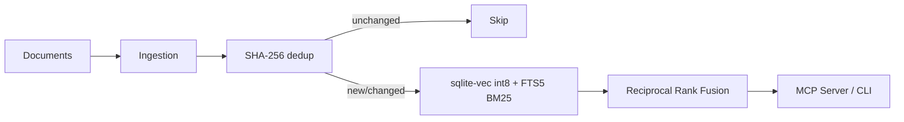

English | [Русский](README_RU.md)

# local-sqlite-rag

A local hybrid RAG engine and MCP server built on Python and SQLite (`sqlite-vec` int8 + FTS5 BM25 + Reciprocal Rank Fusion). It works with any OpenAI-compatible embedding API (LM Studio, Ollama, etc.).

## Pipeline

```text
Documents (.md / .txt / .pdf / .fb2 / .fb2.zip / .epub)
        |
        v
   Ingestion (ingest.py)
        |
        v
 SHA-256 deduplication  ----skip if unchanged---->
        |
        v
 Chunking + embed (int8)     +     FTS5 index
        |                            |
        +-------- SQLite DB ---------+
                     |
                     v
        Hybrid retrieval (search.py / MCP)
                     |
         +-----------+-----------+
         |                       |
   sqlite-vec (int8)      FTS5 BM25
         |                       |
         +-----------+-----------+
                     |
                     v
          Reciprocal Rank Fusion
                     |
         +-----------+-----------+
         |                       |
      CLI (search.py)      MCP Server (stdio)
```



## Features

- **Hybrid search + RRF** — merges vector retrieval over `int8` embeddings (`sqlite-vec` / `vec0`) with BM25 full-text search (`FTS5`) via Reciprocal Rank Fusion (`k=60`).
- **No heavy frameworks** — plain Python, stdlib `sqlite3`, and the official `openai` and `mcp` SDKs (no LangChain / LlamaIndex).
- **Incremental indexing** — SHA-256 file hashes; unchanged files are skipped; each document is committed after indexing so large corpora can be interrupted and resumed.
- **Formats** — `.md`, `.txt`, `.pdf`, `.fb2`, `.fb2.zip`, and `.epub`.
- **Series grouping** — the first subdirectory under `--docs` becomes the `series` label (optional filter at query time).
- **Built-in MCP server** — exposes `search_knowledge_base` and `list_series` over `stdio`.

## Requirements

- Python 3.10+
- An OpenAI-compatible embeddings endpoint (default: `http://localhost:1234/v1`, model `text-embedding-bge-m3`)
- Dependencies: `openai`, `sqlite-vec`, `pypdf`, `mcp` (see `requirements.txt` / `pyproject.toml`)

## Installation

### Windows (PowerShell)

```powershell
cd C:\path\to\local-sqlite-rag
python -m venv .venv
.\.venv\Scripts\Activate.ps1
pip install -r requirements.txt
# or: pip install -e .
```

### Linux / macOS (bash)

```bash
cd /path/to/local-sqlite-rag
python3 -m venv .venv
source .venv/bin/activate
pip install -r requirements.txt
# or: pip install -e .
```

### Embedding server

Start a local embeddings server with an OpenAI-compatible `/v1` API, for example:

| Backend   | Typical base URL              | Notes                                      |
|-----------|-------------------------------|--------------------------------------------|
| LM Studio | `http://localhost:1234/v1`    | Load an embedding model (e.g. BGE-M3)      |
| Ollama    | `http://localhost:11434/v1`   | OpenAI-compatible embeddings endpoint      |
| Other     | any `.../v1` URL              | Set `--base-url` / `LM_STUDIO_URL`         |

Default embedding model name: `text-embedding-bge-m3` (override with `--model` / `--embed-model` / `EMBED_MODEL`). The schema expects **1024-dimensional** embeddings quantized to **int8**.

## Usage

### 1. Index documents

**Windows (PowerShell):**

```powershell
python ingest.py --docs .\sample_docs --db .\demo.db
```

**Linux / macOS:**

```bash
python ingest.py --docs ./sample_docs --db ./demo.db
```

Optional flags: `--base-url`, `--model`, `--batch-size` (default 64), `--chunk-size` (1600), `--overlap` (250).

### 2. Search via CLI

```powershell
python search.py --db .\demo.db --query "how does RRF merge search results"
```

```bash
python search.py --db ./demo.db --query "how does RRF merge search results"
```

With answer generation via a local chat model:

```powershell
python search.py --db .\demo.db --query "how does RRF merge search results" --chat-model gemma-4-12b-it
```

Optional flags: `--series`, `--top-k` (default 5), `--base-url`, `--embed-model`, `--chat-model`.

## Evaluation (`eval.py`)

`eval.py` runs hybrid retrieval (vector + FTS + RRF) against a JSON dataset and reports aggregate metrics.

### Metrics (from code)

| Metric | Meaning |
|--------|---------|
| **Recall@K** | `1.0` if any of the top-K hit titles contains at least one string from `expected_title_substr` (case-insensitive); otherwise `0.0`. Averaged over queries. |
| **MRR** | Reciprocal rank of the first title match (`1 / rank`), or `0.0` if none. Averaged over queries. |
| **Keyword Hit** | Fraction of `expected_keywords` that appear (case-insensitive) in the concatenated content of the top-K hits. Averaged over queries. |
| **Faithfulness** | Optional LLM-as-judge score in `[0.0, 1.0]`: how well the generated answer is grounded in retrieved context. Only when `--chat-model` is set. |
| **Relevance** (`answer_relevance`) | Optional LLM-as-judge score in `[0.0, 1.0]`: how directly and completely the answer addresses the query. Only when `--chat-model` is set. |

If `expected_title_substr` is empty, Recall and MRR are treated as `1.0` for that item. If `expected_keywords` is empty, Keyword Hit is `1.0`.

### Dataset format (`sample_eval.json`)

```json
[
  {
    "query": "...",
    "series": null,
    "expected_title_substr": ["readme", "architecture"],
    "expected_keywords": ["RRF", "FTS5"]
  }
]
```

### Run evaluation

**Windows (PowerShell):**

```powershell
python eval.py --db .\demo.db --eval-file .\sample_eval.json
```

**Linux / macOS:**

```bash
python eval.py --db ./demo.db --eval-file ./sample_eval.json
```

With LLM judge scores:

```powershell
python eval.py --db .\demo.db --eval-file .\sample_eval.json --chat-model gemma-4-12b-it
```

Optional flags: `--top-k` (default 10), `--url` (default `http://localhost:1234/v1`), `--embed-model`, `--chat-model`.

## MCP Server Tools

Run via `python server.py` or the console script `local-sqlite-rag` (see `pyproject.toml`). Environment variables:

| Variable       | Default                         | Purpose              |
|----------------|---------------------------------|----------------------|
| `RAG_DB_PATH`  | `<repo>/demo.db`                | SQLite database path |
| `LM_STUDIO_URL`| `http://localhost:1234/v1`      | Embeddings API base  |
| `EMBED_MODEL`  | `text-embedding-bge-m3`         | Embedding model name |

### `search_knowledge_base`

| Argument | Type            | Default | Description                                      |
|----------|-----------------|---------|--------------------------------------------------|
| `query`  | `str`           | required| Natural-language search query                    |
| `series` | `str \| None`   | `None`  | Optional series filter                           |
| `top_k`  | `int`           | `10`    | Number of RRF-fused hits to return               |

**Response:** a single string. Successful hits are blocks joined by `\n\n---\n\n`:

```text
[1] <title> (series: <series>, chunk: <chunk_index>, score: <rrf_score>)
<content>
```

Other outcomes:

- DB missing: `Ошибка: файл базы данных не найден по пути <path>`
- No hits: `По данному запросу в базе знаний ничего не найдено.`

Internally the tool embeds the query, runs vector and FTS searches with `limit=20` each, merges with RRF (`k=60`), then truncates to `top_k`.

### `list_series`

No arguments.

**Response:** lines of the form `- <series>: <n> файл(ов)`, ordered by `series`. Or:

- DB missing: `Ошибка: файл базы данных не найден по пути <path>`
- Empty DB: `База знаний пуста.`

### `mcp.json` (Cursor / LM Studio)

**Windows:**

```json
{
  "mcpServers": {
    "sqlite-rag": {
      "command": "C:\\path\\to\\local-sqlite-rag\\.venv\\Scripts\\python.exe",
      "args": [
        "C:\\path\\to\\local-sqlite-rag\\server.py"
      ],
      "env": {
        "RAG_DB_PATH": "C:\\path\\to\\local-sqlite-rag\\demo.db",
        "LM_STUDIO_URL": "http://localhost:1234/v1",
        "EMBED_MODEL": "text-embedding-bge-m3"
      }
    }
  }
}
```

**Linux / macOS:**

```json
{
  "mcpServers": {
    "sqlite-rag": {
      "command": "/path/to/local-sqlite-rag/.venv/bin/python",
      "args": [
        "/path/to/local-sqlite-rag/server.py"
      ],
      "env": {
        "RAG_DB_PATH": "/path/to/local-sqlite-rag/demo.db",
        "LM_STUDIO_URL": "http://localhost:1234/v1",
        "EMBED_MODEL": "text-embedding-bge-m3"
      }
    }
  }
}
```

## License

MIT — see [LICENSE](LICENSE).
